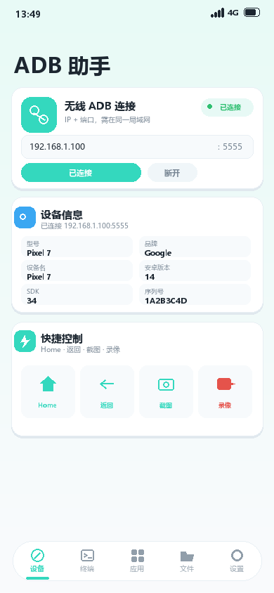
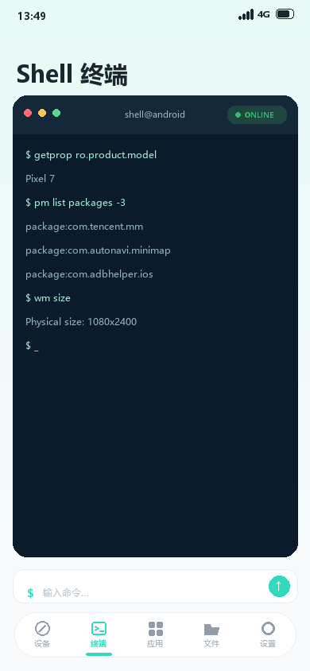
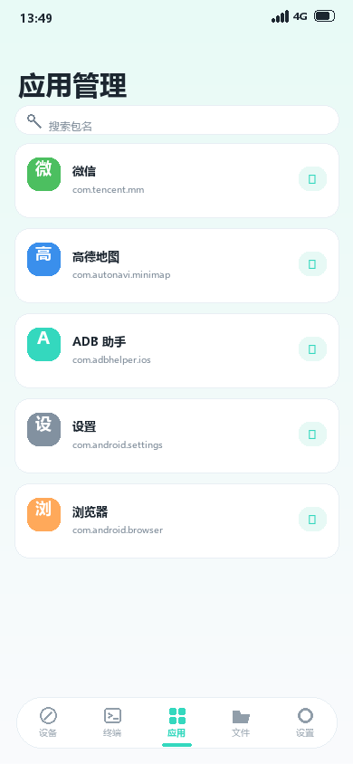
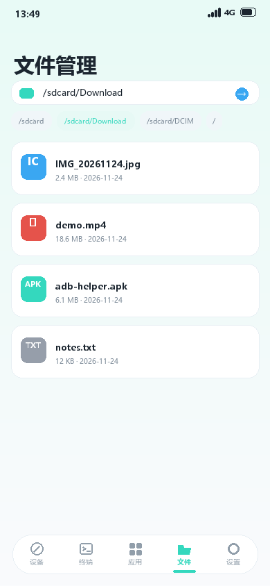
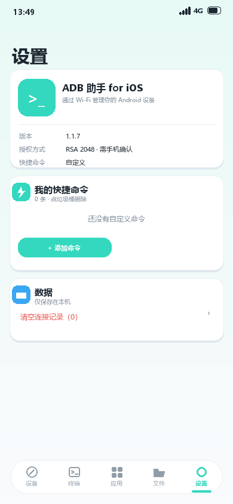

# ADB 助手 for iOS

在 iPhone / iPad 上通过 Wi-Fi 调试 Android 设备的小工具：SwiftUI 界面 + 纯 Swift 实现的原生 ADB 协议（CNXN / AUTH / OPEN / WRTE + file sync），不依赖任何第三方库，也不需要电脑中转。

> 未越狱的 iOS 无法访问 USB，所以本项目只支持**网络 ADB（TCP 5555）**，功能对标 Android 上的「ADB 工具」类 App。

## 功能

| 模块 | 说明 |
| --- | --- |
| 无线连接 | 输入 `IP:端口`（默认 5555），RSA 认证，连接记录一键直连 |
| 设备信息 | 22 项只读属性：型号、品牌、设备名、安卓版本、SDK、序列号、制造商、硬件平台、CPU 架构、编译信息、安全补丁、活动槽、启动验证、内核、SELinux、存储等 |
| 快捷控制 | Home、返回、截图、录像（四个按钮，截图/录像入口都在这里） |
| Shell 终端 | 任意 `adb shell` 命令、快捷命令、命令与输出分色、可拖选复制 |
| 应用管理 | 应用列表（含中文名）、搜索、启动、强停、冻结 / 解冻、清数据、卸载、安装 APK（带进度） |
| 文件管理 | 浏览设备目录（含 `/data` 等系统路径）、上传、下载到系统「存储到文件」面板自选位置、删除 |
| 截图 | `exec-out screencap -p` 纯流式取图，**不在被控设备留下任何文件**，预览后可存相册 |
| 录像 | `screenrecord`，可随时停止；**默认自动保存到相册**，失败时回退到「文件」App |

## 界面预览

| 设备 | Shell 终端 | 应用管理 |
| --- | --- | --- |
|  |  |  |

| 文件管理 | 设置 |
| --- | --- |
|  |  |

预览图是脚本生成的界面示意图（`scripts/gen_screenshots.py`），换了配色或布局可以重新生成。

## 安装

### 方式一：装现成的未签名 IPA

1. 到 [Releases](../../releases) 下载最新的 `ADBHelper.ipa`。
2. 用 [Sideloadly](https://sideloadly.io/)、[AltStore](https://altstore.io/) 或自签工具（爱思助手、TrollStore 等）用你自己的 Apple ID 签名安装。
3. 免费 Apple ID 的签名**有效期 7 天**，到期需要重新签名；付费开发者账号为 1 年。

> IPA 本身不签名，必须经你的证书重签才能装到设备上。

### 方式二：自己编译

需要 macOS + Xcode 15 以上：

```bash
brew install xcodegen
xcodegen generate
open ADBHelper.xcodeproj      # 选自己的 Team，真机运行
```

命令行打包（CI 用的就是这套，产物是未签名 IPA）：

```bash
xcodebuild -project ADBHelper.xcodeproj -scheme ADBHelper \
  -configuration Release -destination 'generic/platform=iOS' \
  -archivePath build/ADBHelper.xcarchive archive
```

仓库自带 GitHub Actions（`.github/workflows/build.yml`）：推到 `main` 会自动编译并把 IPA 发到 Releases，tag 形如 `v1.1.7-b28`（版本号 + 构建号），完整保留历史版本，Release 说明里自动带上本次提交记录。

## 使用前提（Android 端）

1. 打开「开发者选项」→ 开启「USB 调试」。
2. 让设备监听 5555 端口，二选一：
   - 系统自带「无线 ADB」开关（部分国产 ROM 有），打开后默认端口 5555；
   - 或者用电脑执行一次 `adb tcpip 5555`（需要先用 USB 连一次，之后可以拔线）。
3. iPhone 与 Android 必须在**同一 Wi-Fi / 局域网**，且路由器不能开启 AP 隔离 / 访客网络隔离。
4. 首次连接时手机上会弹出「允许 USB 调试吗？」的 RSA 指纹确认，勾选「一律允许」并确定。

## 一些实现说明

- **截图**走 `exec-out screencap -p`，PNG 数据直接流回 iPhone，不会在被控设备写文件。
- **录像**用系统自带的 `screenrecord`：跑在一个常开的 adb shell 通道里（`exec screenrecord`），停止时发送 `SIGINT`，让它把 MP4 的 moov 写完再退出，然后通过 sync 协议拉回本机。默认分辨率启动失败会自动降级到 `--size 1280x720`，临时目录不可写会退到 `/sdcard`；拉取完成后**立即删除设备端文件**，下次连接还会清理历史残留。
- 录像**不含声音**，系统限制单段最长约 180 秒；停止后自动存相册，相册权限被拒时保留在「文件」App。
- **文件下载**先拉回 App 沙盒，再调起系统「存储到文件」面板，由你选择保存位置；不会偷偷只写在沙盒里。
- 终端使用只读 `UITextView` 渲染富文本，命令与输出分色，支持长按拖选任意内容复制。
- 所有 ADB 操作在一条串行队列上跑，多路复用按 `localId` 分发，兼容部分 ROM 的 OKAY 参数顺序差异。

## iOS 系统限制（做不到的部分）

未越狱的 iOS 无法直接访问 USB 设备，因此不能实现：

- USB ADB / Fastboot / 刷机 / 分区操作
- scrcpy 实时投屏、相机远控
- Android 11+「无线调试」的配对码（SPAKE2）配对，只能连接已开放 5555 端口的设备
- 后台常驻通知栏服务

这是平台能力问题，不是代码能绕过的。

## 安全与隐私

- **内置 ADB RSA 私钥**：`ADBHelper/AdbKeyData.swift` 里有一把编译进 App 的密钥。任何拿到这把密钥的人，只要某台 Android 设备曾经授权过它，就能在同一网络下连接该设备。若你不希望使用公共密钥，执行 `python3 scripts/gen_adb_key.py` 重新生成（需要 `cryptography`），再重新编译，之后每台设备需要重新授权一次。
- **不联网上报**：应用不包含任何统计、崩溃上报或远程接口，只与你在界面里填写的设备 IP:5555 通信。
- **不留痕迹**：截图不落盘；录像的临时文件在拉取后立即删除。
- 请只在**自己拥有或已获得机主明确授权**的设备上使用。

## 目录结构

```
ios-adb-helper/
├── ADBHelper/
│   ├── ADBHelperApp.swift       应用入口
│   ├── AdbProtocol.swift        ADB 包协议、TCP 传输、RSA 认证
│   ├── AdbDevice.swift          设备操作、文件同步、截图与录像
│   ├── AdbKeyData.swift         内置 RSA 密钥（由脚本生成，勿手改）
│   ├── DeviceViewModel.swift    共享状态与连接管理
│   ├── Models.swift             数据模型
│   ├── Theme.swift              视觉风格与复用组件
│   ├── TerminalTextView.swift   可选中的终端文本视图
│   ├── DocumentPicker.swift     UIKit 文件导入选择器
│   ├── DocumentExporter.swift   UIKit 系统「存储到文件」面板
│   ├── Info.plist
│   ├── Assets.xcassets          应用图标
│   └── Views/                   设备、终端、应用、文件、设置页
├── scripts/
│   ├── gen_adb_key.py           生成 / 轮换 ADB 密钥
│   ├── gen_icon.py              生成 App 图标
│   ├── gen_screenshots.py       生成 README 预览图
│   └── download_ipa.py          从 Releases 下载最新 IPA
├── docs/screenshots/            预览图
├── project.yml                  XcodeGen 工程描述
└── .github/workflows/build.yml  云端编译与发版
```

## 常见问题

- **一直连不上**：先确认设备 5555 端口真的开着（`nc -z IP 5555` 或电脑上 `adb connect IP:5555`），再检查是否开启了 AP 隔离。
- **弹不出授权框**：删掉设备上「开发者选项 → 撤销 USB 调试授权」后重连。
- **录像失败**：界面会显示设备返回的原始报错（如 `Failed to configure video encoder`）。部分机型的 `screenrecord` 被裁剪或受 SELinux 限制，这种情况无法通过代码绕过。
- **相册里找不到录像**：检查是否给了「添加照片」权限，权限被拒时会退回「文件」App。

## License

[MIT](LICENSE)

## 免责声明

本项目仅供学习与个人设备管理使用。请勿用于未经授权的设备；因使用本工具造成的一切后果由使用者自行承担。
